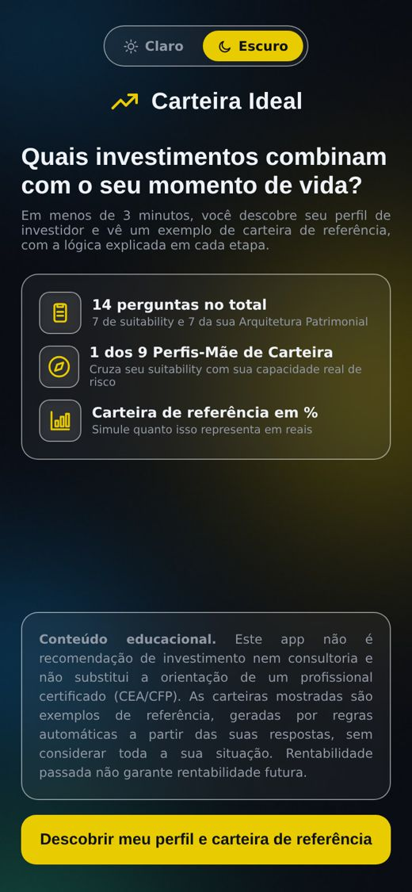
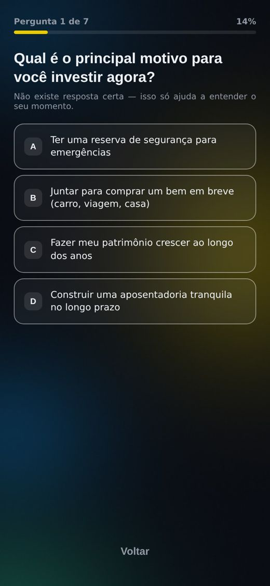
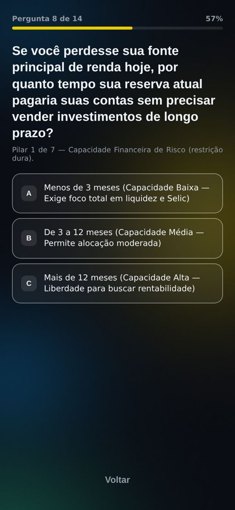
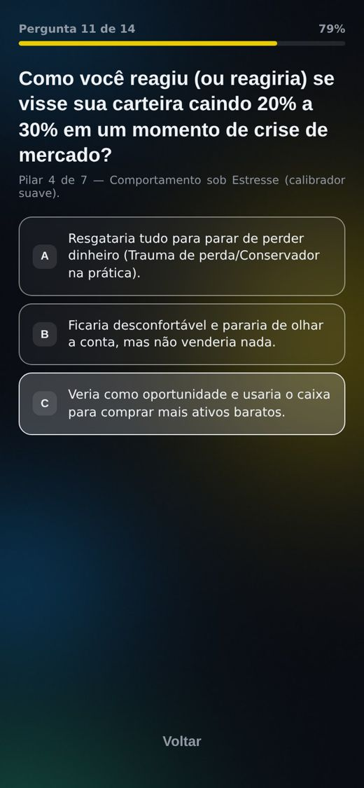
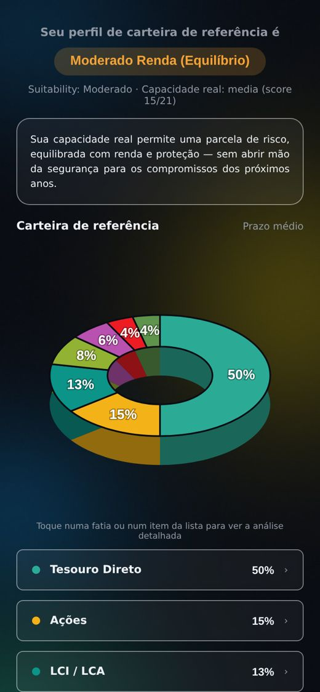
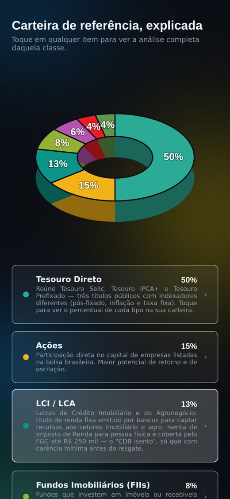
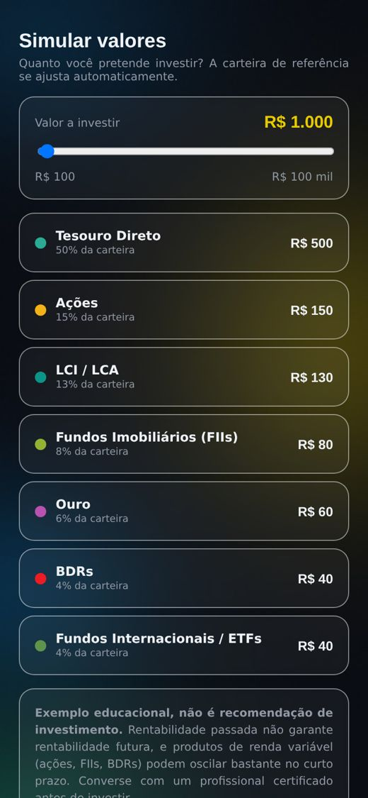
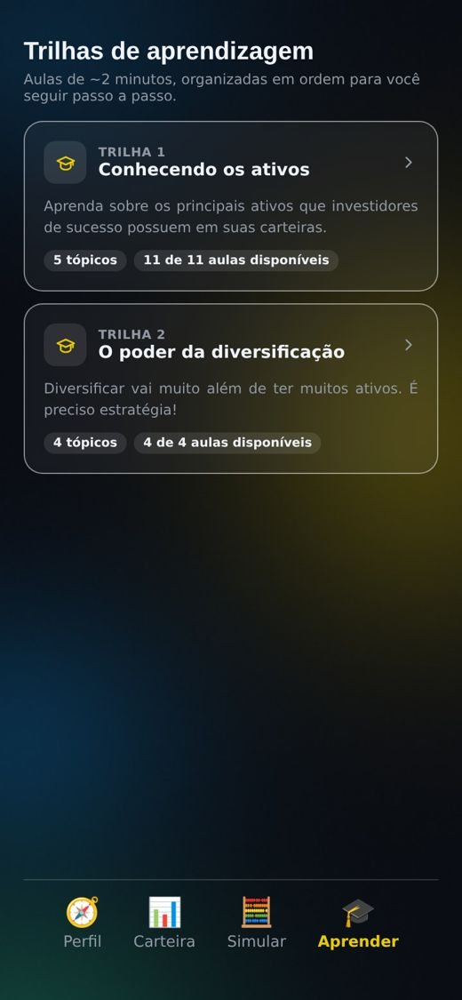

# 4. Jornada do cliente

Capturas feitas em 22/09/2026 num navegador real, em tela de celular (390 × 844), com o site rodando localmente **junto com a API verdadeira**. O perfil de exemplo resultou em **"5. Moderado Renda (Equilíbrio)"**. Nas telas que rolam, a imagem mostra a parte de cima.

```
Instagram (bio) → Landing → Onboarding → Idade → 7 perguntas de Suitability
→ 7 perguntas de Arquitetura Patrimonial → Processando (chamada à API) → Resultado
→ abas: Perfil · Carteira (→ Detalhe do ativo) · Simular

Landing → Simule FII           (./app/?tela=simuleFii, sem questionário)
Landing → Aprender (→ Trilha → Aula; curso de Candlesticks e livro no fim da tela)
                               (./app/?tela=aprender, sem questionário)
```

---

## Etapa 1 · Chegada

### 1.1 Landing "link na bio" (`/`)


Primeira tela para quem toca no link da bio do Instagram.

- **Botão amarelo**: "Descobrir meu perfil e carteira de referência" → abre o app. Para quem já respondeu neste aparelho, vira "Ver minha carteira de referência" e abre direto no resultado.
- **🏢 Simule FII**: abre direto a tela Simule FII do app, sem questionário.
- **🎓 Aprender**: abre direto a tela Aprender do app, sem questionário. O **Curso de Candlesticks** e o livro **Educação Financeira Infantil**, que antes ficavam aqui, estão no fim dessa tela (decisão D11).
- **Falar comigo por e-mail**, ícones de Instagram e YouTube, alternância de tema claro/escuro.

<br clear="all">

### 1.2 Onboarding do app (`/app/`)


Explica a promessa em três pontos: 14 perguntas (7 de suitability e 7 de Arquitetura Patrimonial), 1 dos 9 Perfis-Mãe e carteira de referência em % com simulador em reais. Traz o **aviso educacional** completo antes de qualquer pergunta.

<br clear="all">

### 1.3 Idade


Controle deslizante de 18 a 90 anos. A idade alimenta a trava "mais de 60 anos com objetivo de aposentadoria rebaixa 1 nível de risco".

<br clear="all">

---

## Etapa 2 · Questionário (14 perguntas)

### 2.1 Suitability, perguntas 1 a 7


Uma pergunta por tela, com barra de progresso ("Pergunta 1 de 7"). Tocar numa opção já avança; "Voltar" permite corrigir. Temas: objetivo, prazo, tolerância a queda, reserva de emergência, patrimônio disponível, experiência e reação a notícias de crise.

<br clear="all">

### 2.2 Arquitetura Patrimonial, perguntas 8 a 14


Mesmo formato, com o nome do pilar abaixo do título (ex.: "Pilar 1 de 7 — Capacidade Financeira de Risco (restrição dura)"). Os pilares 1 a 3 são restrições duras (veto); os pilares 4 a 7 são calibradores suaves. Textos completos em [Metodologia](02-metodologia.md#4-menu-de-respostas-objetivas).

<br clear="all">

---

## Etapa 3 · Cálculo

### 3.1 Processando


Animação em três etapas ("Calculando seu score de risco", "Aplicando travas de segurança", "Montando sua carteira sugerida"). **É aqui que o app chama a API** e espera a resposta real, com duração mínima de 1,9 s. Se não houver internet ou a API falhar, a tela mostra "Não conseguimos calcular sua carteira agora" com os botões **Tentar novamente** e **Voltar**.

<br clear="all">

---

## Etapa 4 · Resultado e exploração (barra de abas)

### 4.1 Aba Perfil (resultado)


Mostra o **Perfil-Mãe de Carteira**, a linha "Suitability · Capacidade real · score", um texto explicando o perfil, o **gráfico de rosca** da carteira de referência com a lista de classes, a seção "Por que esse exemplo?" (com os alertas do motor, como sugestão de PGBL/VGBL ou aviso de veto) e o botão **Refazer o questionário**.

<br clear="all">

### 4.2 Aba Carteira e Detalhe do ativo


"Carteira de referência, explicada": cada classe com percentual e descrição. Tocar numa classe abre o **detalhe**: peso na carteira, contexto, divisão interna (ex.: Tesouro IPCA+ / Prefixado / Selic), exemplo por objetivo, diversificação por segmento e a seção "Como um consultor CEA/CNPI analisa".

<br clear="all">

### 4.3 Aba Simular


Controle deslizante de R$ 100 a R$ 100 mil. A carteira de referência é convertida em reais por classe, com aviso educacional no final.

<br clear="all">

### 4.4 Simule FII (🏢), aberta pela landing


No topo, um campo de busca por código (ex.: HGLG11 ou só HGLG) ou por parte do nome (ex.: "kinea"), que encontra qualquer FII listado com dado no mês. Abaixo, a lista principal: os fundos com volume médio acima de R$ 1 milhão por dia, em botões agrupados por setor (Logística, Shoppings, Papel (CRI) etc.), com um texto explicando o critério (decisão D13). Fundo encontrado pela busca e abaixo do corte mostra no cartão o aviso "Fora da lista por liquidez", com o volume médio. Ao escolher um fundo, a tela rola até o cartão, que mostra também o setor e o volume médio. Se a busca não encontra nada, a tela orienta a conferir o código; se o fundo existe mas ficou sem dado no mês, explica o motivo. Para o fundo escolhido: valor da cota (fechamento), **último rendimento** estimado por cota, com o mês de referência, e o percentual sobre o valor da cota. A tabela mostra 10, 50, 100, 500, 1.000 e 5.000 cotas, e uma linha para digitar qualquer quantidade, sempre com o **investimento necessário** ao lado da renda mensal. Não há média de meses (decisão D10). Quando a estimativa do fundo é mais frágil (poucos meses de informe, valor repetido ou cota pouco negociada), o cartão mostra "Estimativa menos confiável" com o motivo.

Abaixo ficam três avisos: **atraso e estimativa da CVM** (informa o mês do rendimento exibido e que o valor pode diferir do anunciado, principalmente em meses de emissão de cotas ou de fechamento de semestre), a frase padrão ANBIMA de rentabilidade passada com a observação sobre isenção de IR, e o aviso educacional padrão. A tela é aberta pela landing, fora da barra de abas, e funciona sem o questionário respondido; "← Início" volta à landing. Se os dados do mês ainda não existirem, mostra "Os dados deste mês ainda não foram carregados".

> Captura feita com os valores reais publicados pelo job em 24/09/2026 (GGRC11: cotação R$ 8,95 e rendimento estimado de R$ 0,098 em ago/2026; o valor anunciado pelo fundo foi R$ 0,10).

<br clear="all">

### 4.5 Aprender, Trilha e Aula, abertas pela landing


Duas trilhas: **Conhecendo os ativos** (5 tópicos, 11 aulas) e **O poder da diversificação** (4 tópicos, 4 aulas). Cada aula tem vídeo do YouTube incorporado, descrição e botão "Próxima aula".

No fim da lista de trilhas, em **Mais conteúdo**, ficam os dois botões que vieram da landing: **Curso de Candlesticks** (Udemy, link de afiliado) e **Educação Financeira Infantil** (livro em PDF liberado por confiança para quem segue o Instagram, com o mesmo diálogo de antes). Como o Simule FII, a tela abre sem questionário e tem "← Início" para voltar à landing.

> Na captura da aula, o quadro do vídeo aparece com a mensagem "Host not in allowlist". Isso é uma limitação do ambiente onde as capturas foram feitas, que bloqueia o YouTube. No site publicado o vídeo carrega normalmente.

<br clear="all">

---

## Comportamentos que não aparecem nas imagens

- **Retomada:** o progresso fica salvo no aparelho. Quem fecha no meio volta de onde parou.
- **Sem a Arquitetura Patrimonial:** o motor aceita só as 7 respostas de suitability e usa a matriz de fallback (seção 5.4 da metodologia). O fluxo atual sempre coleta as 14.
- **Refazer o questionário** apaga os dados do aparelho e volta ao onboarding.
