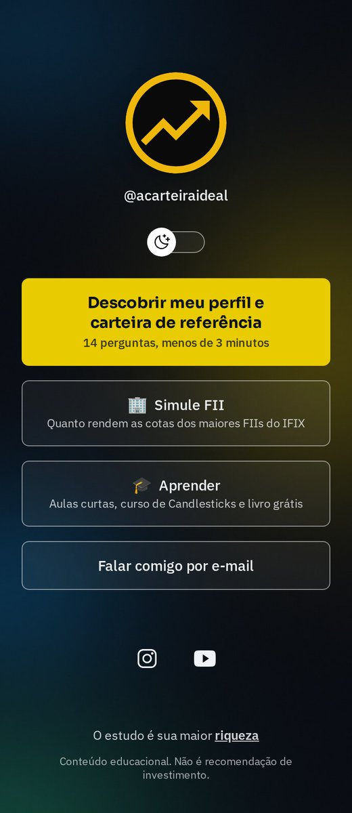
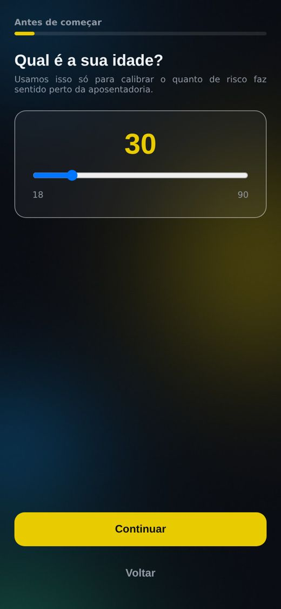
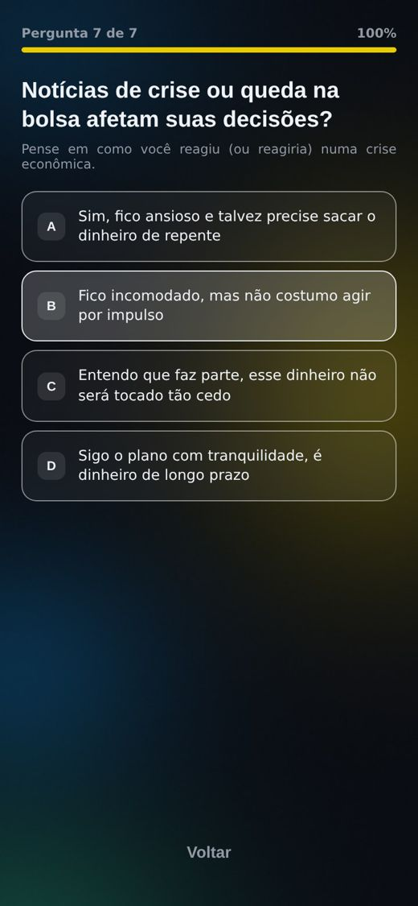
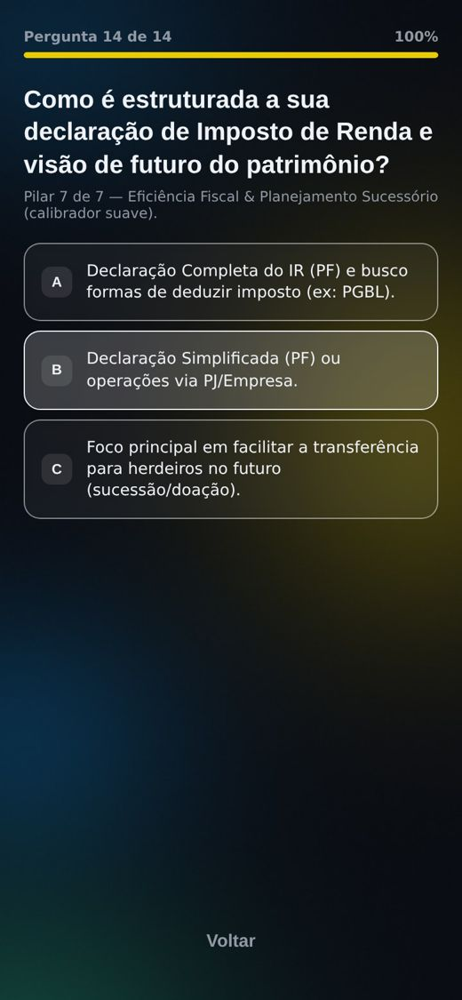
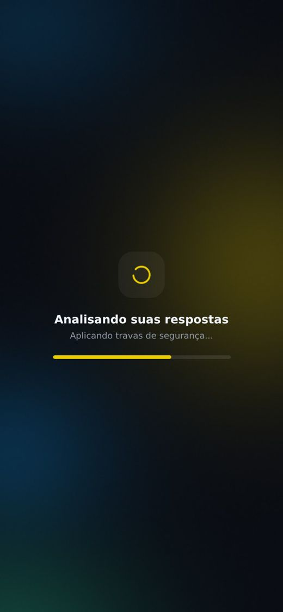
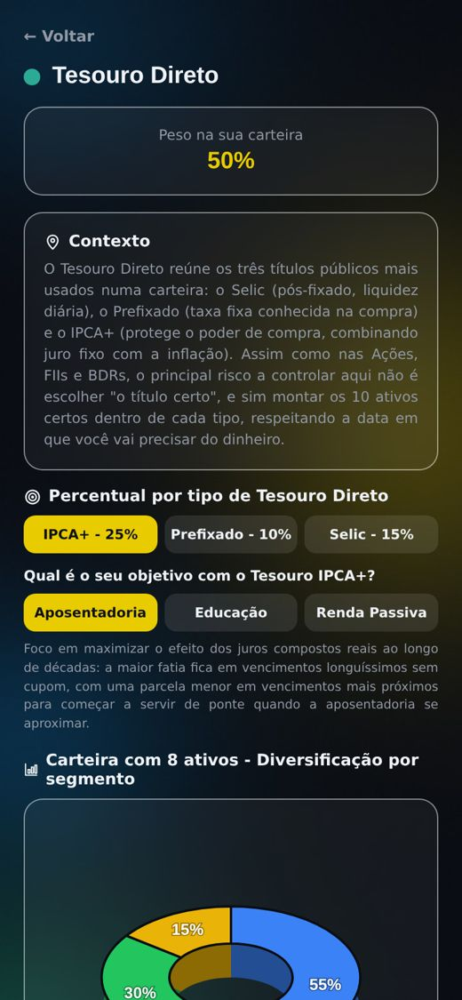
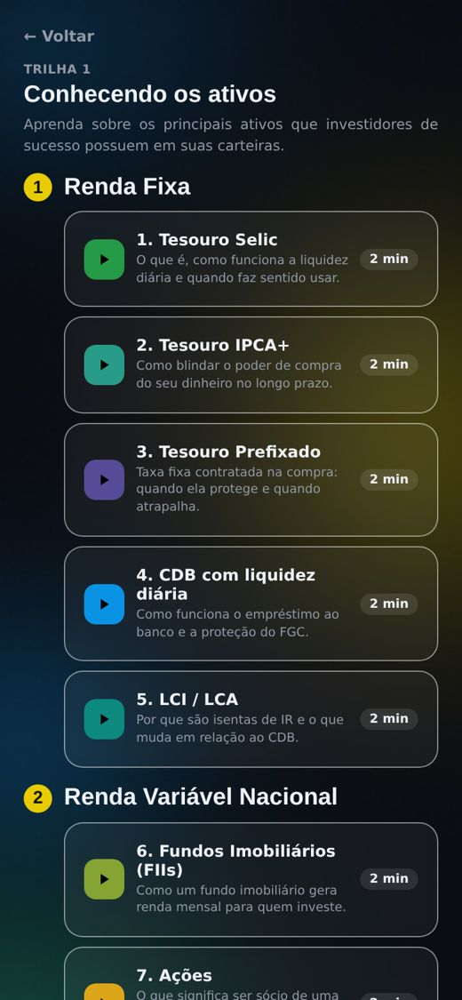
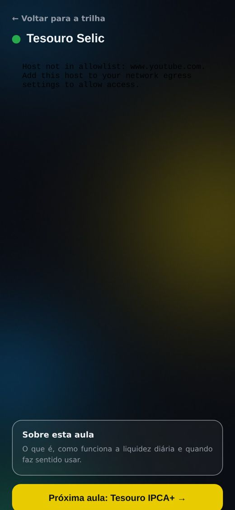

# 4. Jornada do cliente

Capturas feitas em 22/09/2026 num navegador real, em tela de celular (390 × 844), com o site rodando localmente **junto com a API verdadeira**. O perfil de exemplo resultou em **"5. Moderado Renda (Equilíbrio)"**. Nas telas que rolam, a imagem mostra a parte de cima.

```
Instagram (bio) → Landing → Onboarding → Idade → 7 perguntas de Suitability
→ 7 perguntas de Arquitetura Patrimonial → Processando (chamada à API) → Resultado
→ abas: Perfil · Carteira (→ Detalhe do ativo) · Simular

Landing → Meu Mês              (./app/?tela=meuMes, sem questionário; D21, 2º botão desde a D25)
Landing → Aprender (→ Trilha → Aula; livro infantil no fim da tela)
                               (./app/?tela=aprender, sem questionário)
Landing → Simule FII           (./app/?tela=simuleFii, sem questionário)
Landing → Simule Bens (hub)    (./app/?tela=simuleBens, sem questionário; D45) → Imóvel (?tela=simuleImovel; D44) , Carro (?tela=simuleCarro; D47) ou Moto (?tela=simuleMoto; D48)
Resultado (Pilar 1 ou 2 em [A]) → Meu Mês;  Meu Mês (com dívida) → trilha "Sair das dívidas"
```

---

## Etapa 1 · Chegada

### 1.1 Landing "link na bio" (`/`)


Primeira tela para quem toca no link da bio do Instagram.

- **Botão amarelo**: "Descobrir meu perfil e carteira de referência" → abre o app. Para quem já respondeu neste aparelho, vira "Ver minha carteira de referência" e abre direto no resultado.
- **📈 Simule Ativos** (D42, posição D109): logo abaixo do botão amarelo, abre o hub com Simule Ações, Simule Opções, Simule FII, Simule Tesouro Direto, Simule BDR e Simule ETF, sem questionário.
- **🗓️ Meu Mês**: abre direto o controle do mês (contas, cofrinhos das contas anuais, cartão, os três potes e o Modo Recuperação), sem questionário. Fica logo abaixo do botão amarelo, antes do Aprender e dos simuladores: organizar o mês vem antes de simular investimentos (D25; antes, na D21, ficava por último).
- **🎓 Aprender**: abre direto a tela Aprender do app, sem questionário. O livro **Educação Financeira Infantil**, que antes ficava aqui, está no fim dessa tela (decisão D11). O link do curso de Candlesticks foi retirado do site (D22).
- **🏢 Simule FII**: abre direto a tela Simule FII do app, sem questionário.
- **🏛️ Simule Tesouro Direto**, **🌎 Simule BDR** e **🧺 Simule ETF**: abrem direto as respectivas telas, sem questionário.
- **🎯 Simule Opções** (D96 a D108, `?tela=simuleOpcoes`, aberta pelo hub Simule Ativos, logo depois do Simule Ações), com sete abas, sempre educativas e sem indicar operação:
  - **Séries da B3**: todas as opções de ações e ETFs com negócio nos últimos pregões e vencimento em até 6 meses, em tabela ordenável (modelo americana/europeia, gregas, volatilidade implícita), com filtros por tipo, vencimentos mensais e semanais e faixa de strike (campo e controle deslizante), e busca entre os ativos. Em cada linha, os botões **C** (verde, comprar) e **V** (vermelho, vender) montam ali mesmo a compra ou venda de call ou put, com gráfico de resultado, passagem do tempo e gregas.
  - **Top 15 prêmios** (D97 e D98): quem paga o maior prêmio para um mesmo risco, na venda de put ou de call coberta, com colchão, chance de exercício, volatilidade e dívida da empresa ao lado, cruzado com as listas de ações baratas e endividadas.
  - **Tendência** (D99 e D108): o app lê a tendência do ativo, a pessoa escolhe a visão (alta, baixa, lateral, muita oscilação) e vê as estruturas que combinam (trava, condor, borboletas, slide, booster, collar, strangle financiado e outras), montadas com as séries reais, com custo, ganho, perda e chance de lucro.
  - **Gráficos** (D100 a D102): negócios por strike nos vencimentos escolhidos, com calls (amarelo) e puts (azul) e o preço do ativo no centro.
  - **Roda** (D107): um giro da roda (wheel), com a put coberta por caixa e, se exercida, a call coberta, com rendimento, preço efetivo das ações e o manejo da put.
  - **Estratégias** (D103 a D106 e D113): "Monte sua estratégia", que começa com o passo a passo "Qual é o seu objetivo?" (renda, proteção, alta, baixa, ativo parado ou movimento forte, cada um com as estruturas que costumam servir, a razão e o risco), e segue com travas, borboletas, condors, straddles e strangles, venda coberta, collar, THL e diagonais (vencimentos diferentes por perna, D104) e os modelos de renda e proteção do tipo Prefiro PUT; resultado, passagem do tempo, gregas e **manejo** (D105: cenários, desmontagem e rolagem).
  - **Minha posição** (D112): a pessoa cadastra a estrutura que já montou (séries, lado, quantidade, preço da operação e, se houver, as ações; botão "+" para cada perna), e o app reconhece a estrutura, mostra como está hoje pelo último preço, desenha o gráfico e lista as saídas possíveis (manter, encerrar, fechar uma perna, rolar, proteger), cada uma com o resultado e o novo risco. Os dados ficam só no aparelho.
- **Falar comigo por e-mail**, ícones de Instagram e YouTube, alternância de tema claro/escuro.

<br clear="all">

### 1.2 Onboarding do app (`/app/`)


Explica a promessa em três pontos: 14 perguntas (7 de suitability e 7 de Arquitetura Patrimonial), 1 dos 9 Perfis-Mãe e carteira de referência em % com simulador em reais. Traz o **aviso educacional** completo antes de qualquer pergunta.

<br clear="all">

### 1.3 Idade


Controle deslizante de 18 a 90 anos. A idade alimenta a trava "mais de 60 anos com objetivo de aposentadoria rebaixa 1 nível de risco".

<br clear="all">

---

## Etapa 2 · Questionário (14 perguntas)

### 2.1 Suitability, perguntas 1 a 7


Uma pergunta por tela, com barra de progresso ("Pergunta 1 de 7"). Tocar numa opção já avança; "Voltar" permite corrigir. Temas: objetivo, prazo, tolerância a queda, reserva de emergência, patrimônio disponível, experiência e reação a notícias de crise.

<br clear="all">

### 2.2 Arquitetura Patrimonial, perguntas 8 a 14


Mesmo formato, com o nome do pilar abaixo do título (ex.: "Pilar 1 de 7 — Capacidade Financeira de Risco (restrição dura)"). Os pilares 1 a 3 são restrições duras (veto); os pilares 4 a 7 são calibradores suaves. Textos completos em [Metodologia](02-metodologia.md#4-menu-de-respostas-objetivas).

<br clear="all">

---

## Etapa 3 · Cálculo

### 3.1 Processando


Animação em três etapas ("Calculando seu score de risco", "Aplicando travas de segurança", "Montando sua carteira sugerida"). **É aqui que o app chama a API** e espera a resposta real, com duração mínima de 1,9 s. Se não houver internet ou a API falhar, a tela mostra "Não conseguimos calcular sua carteira agora" com os botões **Tentar novamente** e **Voltar**.

<br clear="all">

---

## Etapa 4 · Resultado e exploração (barra de abas)

### 4.1 Aba Perfil (resultado)


Mostra o **Perfil-Mãe de Carteira**, a linha "Suitability · Capacidade real · score", um texto explicando o perfil, o **gráfico de rosca** da carteira de referência com a lista de classes, a seção "Por que esse exemplo?" (com os alertas do motor, como sugestão de PGBL/VGBL ou aviso de veto) e o botão **Refazer o questionário**.

<br clear="all">

### 4.2 Aba Carteira e Detalhe do ativo


"Carteira de referência, explicada": cada classe com percentual e descrição. Tocar numa classe abre o **detalhe**: peso na carteira, contexto, divisão interna (ex.: Tesouro IPCA+ / Prefixado / Selic), exemplo por objetivo, diversificação por segmento e a seção "Como analisar este ativo".

<br clear="all">

### 4.3 Aba Simular


Controle deslizante de R$ 100 a R$ 100 mil. A carteira de referência é convertida em reais por classe, com aviso educacional no final.

<br clear="all">

### 4.4 Simule FII (🏢), aberta pela landing


No topo, um campo de busca por código (ex.: HGLG11 ou só HGLG) ou por parte do nome (ex.: "kinea"), que encontra qualquer FII listado com dado no mês. Abaixo, a lista principal: os fundos com volume médio acima de R$ 1 milhão por dia, em botões agrupados por setor (Logística, Shoppings, Papel (CRI) etc.), com um texto explicando o critério (decisão D13). Fundo encontrado pela busca e abaixo do corte mostra no cartão o aviso "Fora da lista por liquidez", com o volume médio. Ao escolher um fundo, a tela rola até o cartão, que mostra também o setor e o volume médio. Se a busca não encontra nada, a tela orienta a conferir o código; se o fundo existe mas ficou sem dado no mês, explica o motivo. Para o fundo escolhido: valor da cota (fechamento), **último rendimento** estimado por cota, com o mês de referência, e o percentual sobre o valor da cota. A tabela mostra 10, 50, 100, 500, 1.000 e 5.000 cotas, e uma linha para digitar qualquer quantidade, sempre com o **investimento necessário** ao lado da renda mensal. Não há média de meses (decisão D10). Quando a estimativa do fundo é mais frágil (poucos meses de informe, valor repetido ou cota pouco negociada), o cartão mostra "Estimativa menos confiável" com o motivo.

Abaixo ficam três avisos: **atraso e estimativa da CVM** (informa o mês do rendimento exibido e que o valor pode diferir do anunciado, principalmente em meses de emissão de cotas ou de fechamento de semestre), a frase padrão ANBIMA de rentabilidade passada com a observação sobre isenção de IR, e o aviso educacional padrão. A tela é aberta pela landing, fora da barra de abas, e funciona sem o questionário respondido; "← Início" volta à landing. Se os dados do mês ainda não existirem, mostra "Os dados deste mês ainda não foram carregados".

> Captura feita com os valores reais publicados pelo job em 24/09/2026 (GGRC11: cotação R$ 8,95 e rendimento estimado de R$ 0,098 em ago/2026; o valor anunciado pelo fundo foi R$ 0,10).

<br clear="all">

### 4.5 Aprender, Trilha e Aula, abertas pela landing


Três trilhas: **Conhecendo os ativos** (5 tópicos, 11 aulas), **O poder da diversificação** (4 tópicos, 4 aulas) e **Sair das dívidas** (3 tópicos, 9 aulas, D21 Etapa 4). Nas duas primeiras, cada aula tem vídeo do YouTube incorporado, descrição e botão "Próxima aula". As aulas de **Sair das dívidas** são em texto por enquanto ("Leitura · 2 min"), com fontes oficiais e botões para o Meu Mês ou para o questionário; quando os vídeos forem gravados, eles entram acima do texto.

No fim da lista de trilhas, em **Mais conteúdo**, fica o botão que veio da landing: **Educação Financeira Infantil** (livro em PDF liberado por confiança para quem segue o Instagram). O link do curso de Candlesticks (Udemy) foi retirado na D22. Como o Simule FII, a tela abre sem questionário e tem "← Início" para voltar à landing.

> Na captura da aula, o quadro do vídeo aparece com a mensagem "Host not in allowlist". Isso é uma limitação do ambiente onde as capturas foram feitas, que bloqueia o YouTube. No site publicado o vídeo carrega normalmente.

<br clear="all">

---

### 4.6 Financiar, alugar ou consórcio? (🏠), aberta pelo hub Simule Bens
O cartão da landing abre o hub **Simule Bens** (`?tela=simuleBens`, D45), com um cartão para Imóvel, um para Carro (D47) e um para Moto (D48). O comparativo de imóvel é uma tela avulsa (`?tela=simuleImovel`), sem questionário, com "← Simule Bens" de volta ao hub. À esquerda, o formulário em cinco blocos (imóvel e prazo, premissas de mercado, financiamento, aluguel, consórcio) e a opção de descontar os custos de venda; à direita, no computador, o resultado (no celular ele vem abaixo do formulário, com o atalho "Ir para o resultado ↓"). Os campos já abrem preenchidos com a projeção de longo prazo do Boletim Focus e podem ser trocados.

O resultado aponta **qual dos caminhos (comprar à vista, financiar, consórcio ou alugar) termina com o maior patrimônio líquido** e por quanto. A compra à vista entra quando o campo "Dinheiro disponível hoje" cobre o imóvel e o ITBI; senão, a tela diz quanto falta e oferece um atalho (D46). E explica: o que é patrimônio líquido e por que os três caminhos usam o mesmo dinheiro; por que o primeiro colocado ficou na frente (decomposição que soma a vantagem); a evolução mês a mês em gráfico; "para onde foi cada real" nos três lado a lado; **cada custo e cada taxa de cada caminho**, com valor e explicação; o ponto de virada e o efeito de a contemplação do consórcio demorar; e todas as premissas usadas. No fim, o aviso de que é conta matemática e não indica banco, administradora nem produto (D44).

O comparativo de **carro** (`?tela=simuleCarro`, D47) segue o mesmo molde, com quatro caminhos: comprar à vista, financiar (Price), consórcio e **ficar sem carro** (um gasto mensal único de mobilidade que a pessoa informa: assinatura, locação ou aplicativo). Como o carro perde valor, o resultado mostra **duas leituras da mesma conta, lado a lado**: o **custo de mobilidade por mês** (destaque; líquido do rendimento do dinheiro e bruto) e o **patrimônio líquido final**. O formulário tem botões para 0 km ou seminovo (que recarregam só os valores de partida de depreciação e manutenção) e blocos de depreciação e custos de dono (IPVA, seguro, manutenção, uso), financiamento, consórcio e sem carro. O ponto de virada é o **gasto mensal sem carro** a partir do qual ter o carro compensa. Cada custo (emplacamento, IOF, gravame, juros, IPVA, seguro, manutenção, uso, taxa de administração, fundo de reserva) é explicado em linguagem simples, e a perda de valor do carro aparece como linha própria. Mesmo aviso: conta matemática, não indica banco, administradora, locadora, aplicativo nem produto.

O comparativo de **moto** (`?tela=simuleMoto`, D48) é o mesmo do carro com **valores de partida de moto** (valor, depreciação, seguro maior por risco de roubo, manutenção mais frequente, juros maiores, prazos menores) e texto próprio em cada frase. A primeira versão cobre **moto de uso pessoal**; a moto de trabalho, que gera renda, não está modelada e a tela e a página de SEO dizem isso.

## Comportamentos que não aparecem nas imagens

- **Retomada:** o progresso fica salvo no aparelho. Quem fecha no meio volta de onde parou.
- **Sem a Arquitetura Patrimonial:** o motor aceita só as 7 respostas de suitability e usa a matriz de fallback (seção 5.4 da metodologia). O fluxo atual sempre coleta as 14.
- **Refazer o questionário** apaga os dados do aparelho e volta ao onboarding.
- **Ponte com o Meu Mês (D21, Etapa 4):** nas perguntas 8 e 9 (Pilares 1 e 2), quem já usa o Meu Mês neste aparelho vê qual opção combina com o que anotou lá, com o motivo em números. É só sugestão: nada é marcado sozinho, e o orçamento não sai do aparelho. No resultado, quem respondeu [A] no Pilar 2 (ou, sem isso, [A] no Pilar 1) vê o cartão "Antes de investir" com o botão para o Meu Mês; os demais não veem nada de dívida.
